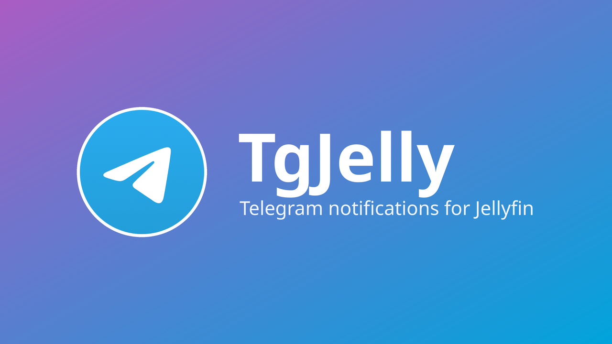
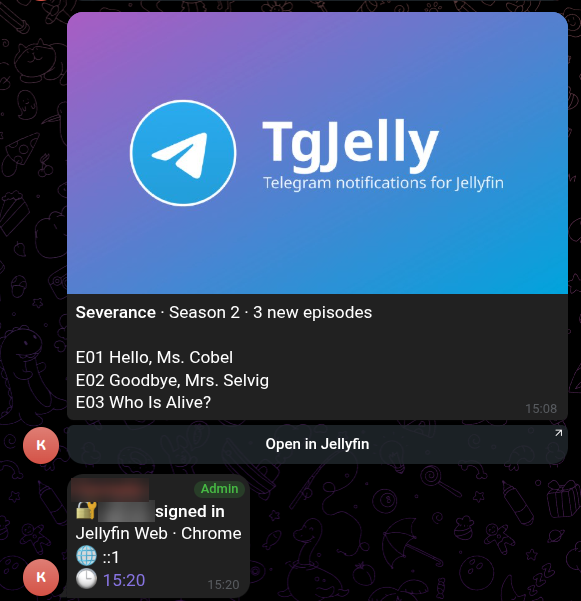
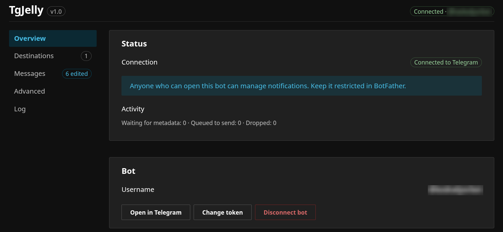
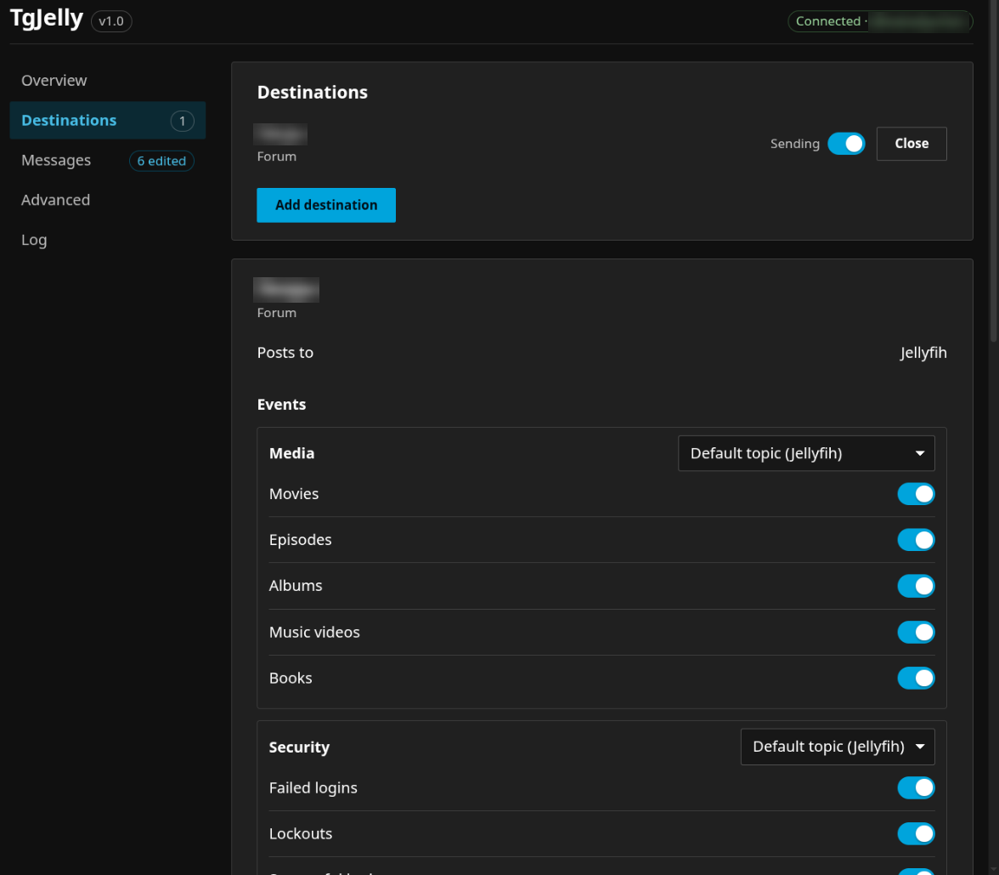
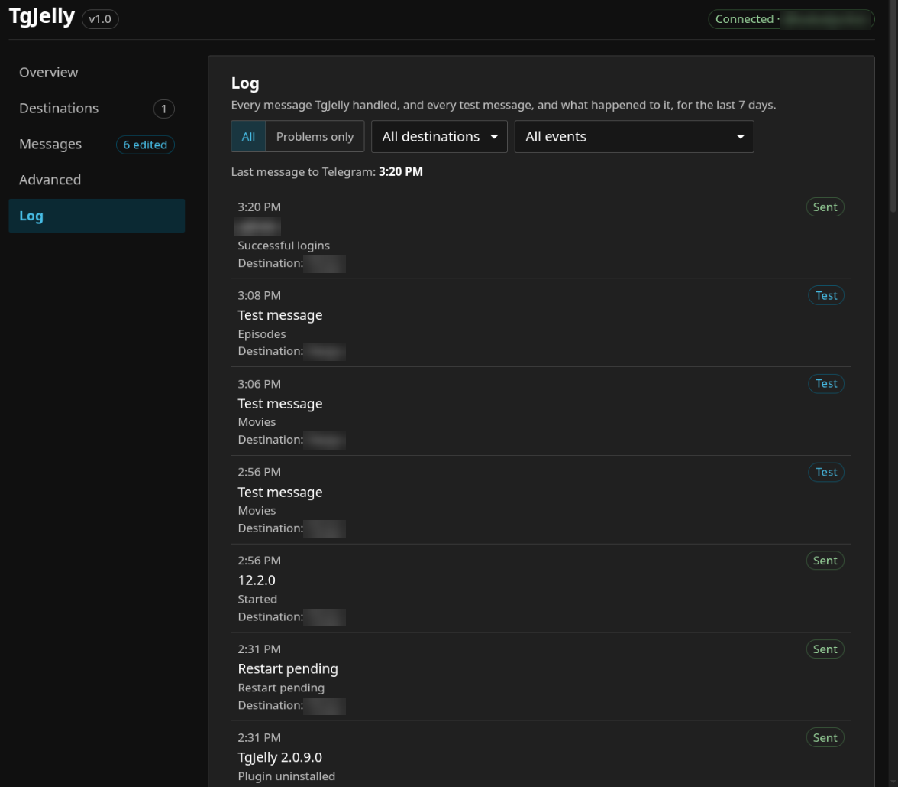
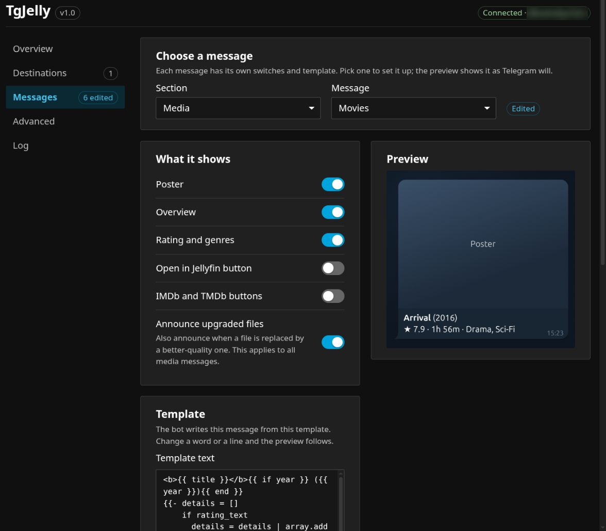

<p align="center">
  
</p>

<p align="center">
  <a href="https://github.com/MrSnowball-dev/tgjelly_plugin/releases/latest"></a>
  
  
  <a href="https://github.com/MrSnowball-dev/tgjelly_plugin/actions/workflows/ci.yml"></a>
  <a href="https://github.com/MrSnowball-dev/tgjelly_plugin/releases"></a>
  <a href="LICENSE"></a>
</p>

<p align="center">
  <a href="#install">Install</a> ·
  <a href="#set-up">Set up</a> ·
  <a href="#events">Events</a> ·
  <a href="#message-templates">Templates</a> ·
  <a href="#troubleshooting">Troubleshooting</a>
</p>

TgJelly puts a Telegram bot inside your Jellyfin server. It sends notifications to the chats, groups and channels you choose.

- **Media:** new movies, episodes, albums, music videos and books, with poster, overview, rating and links. A season added at once arrives as one message, not twenty.
- **Security:** failed logins, lockouts, new and deleted users, password changes.
- **Server:** startup, Jellyfin updates, plugin changes, failed scheduled tasks.

You set it up from the Jellyfin dashboard or from the bot itself. Every message is a template you can change, and forum groups can get a topic per kind of event.

<p align="center">
  
</p>

## Requirements

| | |
|---|---|
| Jellyfin | 10.11 or 12, one build for both |
| Telegram | any account, to create the bot with @BotFather |
| Network | the server must reach `api.telegram.org`, directly or through a SOCKS5 or HTTP proxy |

## Install

1. In Jellyfin, open Dashboard, Plugins, Repositories, and add this repository:

   ```
   https://mrsnowball-dev.github.io/tgjelly_plugin/manifest.json
   ```

2. Open the plugin Catalog, install "TgJelly", and restart Jellyfin.

Updates come through the same Catalog. Each [release](https://github.com/MrSnowball-dev/tgjelly_plugin/releases) also has the zip, if you prefer to install by hand.

## Set up

1. Open @BotFather in Telegram and send `/newbot`. Copy the token it gives you.
2. Restrict access to your bot in BotFather's Mini App, so that only the people you want can use it.
3. In Jellyfin, open the Dashboard and pick **Telegram** in its menu. Paste the token.
4. Press **Open in Telegram**. Telegram opens the chat with the bot.
5. In the bot, tap **Start**. With no destinations yet, it offers **Add to a channel** and **Add to a group**: choose the chat in Telegram. The destination starts with every event on. To add more later, open **Destinations** and tap **Add destination**.



TgJelly doesn't change the bot's name, description, photo or command menu: set them in BotFather as you like. The commands (/menu, /status, /test, /help) work whether or not they are in the menu.

You never type a chat ID. The Advanced section of the dashboard has manual options for the rare case where the main way fails.

The custom icons on the bot's buttons and headings show only when the bot owner's Telegram account has Premium; otherwise the bot shows plain labels.

## Events

Each destination has event switches, grouped into Media, Security and Server. A new destination starts with every event on; turn off what you don't want. When a later version adds a new kind of event, it is turned on only for destinations that still have every event on.

You can also limit a destination to some libraries, send media, security or server events silently, pause a destination, and send a test message.



## The dashboard

The **Telegram** page in the Jellyfin Dashboard has a sidebar of sections. On a phone it becomes a row of tabs. The header shows the connection state and the plugin's version, such as v1.0; click the version to open its release page.

- **Overview:** the connection state, notices, and the bot. With no bot connected, it starts with Connect. A notice reminds you to restrict the bot's access in BotFather.
- **Destinations:** the chats that get messages, with their events, libraries, silent groups, pause, and test.
- **Messages:** one page per message: what it shows, its template, a preview, and the fields you can use.
- **Advanced:** the bot token (hidden until you press Show), proxy, batching, update checks, adding a chat by ID, and diagnostics.
- **Log:** what happened to every message TgJelly sent or held back, and to every test message.

There are no Save buttons. Every setting saves itself, and a short label beside it says what happened. "Saved" fades after two seconds. "Not saved" stays, with the reason, until you fix the value. A value that is not valid is never saved. Buttons are only for actions, like Remove, Send test and Reset.

When something goes wrong, the message says what happened and what to do next, in Telegram's or the network's own words where there are any.

### Destinations

A destination shows a status only when something is wrong: Photos blocked, Needs permissions, Topic missing or Lost. A healthy one shows nothing. Under its name you see the kind of chat: Channel, Group, Supergroup, or Forum for a group with topics. In the editor, the events are grouped into Media, Security and Server.

In a forum (a group with topics), the editor says which topic the destination posts to. Media, Security and Server each have a topic choice on their title: the default topic, another topic, a new one TgJelly creates, or a link to an existing topic. Media can also be split with **Separate topics for each event**; only then does each media event get its own choice. Anything left on the default topic goes where it does today. In the bot, the destination's **Topics** button offers the same choices (except pasting a link). TgJelly knows a topic's name once it has created it or posted into it, and follows renames: when a topic it uses, or General, is renamed in Telegram, the new name shows in the dashboard and the bot. If a chosen topic is deleted, its messages go to the default topic and the editor shows "Topic gone". The **Advanced** block at the bottom of the editor, folded until you open it, shows the chat ID and the topic IDs.

Disconnecting the bot keeps your destinations, so they work again when you connect the same bot. The confirmation has a switch, "Also remove all destinations", that is off by default.

### Messages

Pick a **Section** (Media, Security or Server) and then a **Message**. Media also has the Digest. A label next to the pickers says whether the message is Built-in or Edited. The page shows, top to bottom:

- **What it shows:** switches for this message only. Media messages can show the poster, the overview, the rating and genres, the Open in Jellyfin button and the IMDb/TMDB buttons. A switch that does not fit a message is hidden. Security and Server messages have one switch, Poster, which is off by default. When it is on, the message is sent with the TgJelly logo as its picture.
- **Public URL:** it appears inside the Open in Jellyfin switch, while that switch is on. It is one setting for every message's button.
- **Template:** the text of the message. See below.
- **Preview:** how the message looks in Telegram, with its bubble, photo and buttons. On a wide screen it stays beside the template.
- **Available fields** and **Formatting:** two tables, closed until you click their titles. Click the first cell of a row to put that field or tag in the template at the cursor. If you selected text, a formatting tag wraps it.

Hover a piece of the template, such as one field, an `if` block or a run of text, and the part of the preview it wrote lights up. It works the other way round too.

### Advanced

- **Proxy:** the user name and password appear only when the proxy type is SOCKS5 or HTTP. Only these two types work with a bot. MTProto proxies do not.
- **Update checks:** TgJelly watches Jellyfin releases. Three switches pick the kinds you hear about: fixes for your version (10.11.1 to 10.11.2), new releases (10.11 to 10.12) and new major versions (10.x to 12.0). With all three off, you get no update messages.
- **Batching:** how long TgJelly waits to collect several items into one message.
- **Diagnostics:** Copy diagnostics makes a report to paste into a bug report. A notice above the button lists what it contains. It never contains the bot token, proxy credentials, chat IDs or chat names, and it does not include the Log.

### Log

The **Log** has one row for each message and each destination, newest first. Each row shows when, the event, the destination, the result and, if it is not Sent, why. A Sent row also says why when a later update of that message failed: the chat then still shows the earlier version. The results are Sent, Waiting, Skipped, Sent late, Sent with built-in, Sent without photo and Failed. Test messages have their own label, Test or Test failed. Click a row that needs attention to see what Telegram said, how many tries there were, and what to do.



Use **Problems only** to hide the rows that went well, and the Destination and Event selects to narrow the list. The top line shows when the last message reached Telegram, and tells you when Jellyfin has sent no events for a day, so you can tell silence from a failure.

The Log keeps 7 days or 5,000 rows, whichever is less. It is stored apart from your settings.

TgJelly sends at most two messages a second, so a big library scan doesn't run into Telegram's flood limits.

## Message templates

Every message is a template, and you can change any of them. Open the message on the Messages page. The editor shows the built-in template, so you start from what you already get. The preview shows how it will look in Telegram. Your changes save themselves a second after you stop typing, unless the template has errors. Press Send test to send it to a destination, and Reset to go back to the built-in one. The poster and buttons keep following their own switches. See [docs/templates.md](docs/templates.md) for the syntax, the fields you can use, and the built-in templates.



## Privacy

- The bot talks to Telegram only. The dashboard page never calls Telegram itself.
- The update check contacts `api.github.com`, and only while at least one destination subscribes to the update event. Otherwise TgJelly makes no other network calls. It uses the same proxy as the bot.
- The bot token and proxy password are never shown again after you save them, and they are removed from logs and reports.
- TgJelly keeps its files in `plugins/configurations/TgJelly/` inside your Jellyfin data folder. Uninstalling the plugin leaves them there.
- The Log keeps what its rows show for 7 days on the server's disk, in `event-log.jsonl` in that folder: media titles, user names for security events such as failed logins, and Telegram's error texts. It never holds the bot token or the messages' full text.

## Troubleshooting

- **Telegram is blocked on your network.** Set a proxy in the Advanced section of the **Telegram** page in the Dashboard.
- **The dashboard page is blank or its buttons do nothing.** The page is an ES module. A strict Content Security Policy, or Cloudflare Rocket Loader, can break it. Disable Rocket Loader for the Jellyfin host and allow the page's scripts in your CSP.
- **"Another app is polling this bot".** Something else is using the same bot token, such as another bot program or a second Jellyfin server. Stop that app. TgJelly connects again by itself once it has stopped.
- **"Another app set a webhook for this bot".** Press **Take over** on the **Telegram** page in the Dashboard. It removes the webhook, so TgJelly can receive updates again.
- **"Another Jellyfin process is using TgJelly's data folder".** Two servers must not share one config folder. This is not supported. Give each server its own.
- **A destination shows "Photos blocked" or "Needs permissions".** Give the bot the rights it needs in that chat, then press **Check again**.

## Build from source

You need the .NET 10 SDK (pinned by `global.json`) with the .NET 9 runtime, Python 3, and Node 22 for the page tests.

```
dotnet build Jellyfin.Plugin.TgJelly.slnx -c Release
dotnet test --solution Jellyfin.Plugin.TgJelly.slnx -c Release --no-build
python3 build/package.py --release 0.0 --output artifacts
```

The last command writes `tgjelly_0.0.0.0.zip` and `manifest.json` to `artifacts/`. A release tag `vX.Y` or `vX.Y.Z` builds version `X.Y.0.0` or `X.Y.Z.0`.

## License

GPL-3.0. See [LICENSE](LICENSE).
